  

  
  
  

   
  

## About me

Hi, I’m **Jiayi Yang** — a student at **Yunnan University** who enjoys learning in public and turning small ideas into things people can use.

- 🌱 Growing through hands-on projects and steady practice.
- 🧢 Hiphop is part of my rhythm and creative energy.
- 🎻 Violin, grade 10 (amateur) — patience sounds good in code too.
- 🥊 **With _hard work_, even geniuses can be overtaken.**

> This profile is a living notebook: the projects, experiments, and lessons will keep evolving.

## What you’ll find here

<table>
  <tr>
    <td width="50%" valign="top">
      <h3>🛠 Build</h3>
      Small experiments, practical tools, and ideas that become clearer one commit at a time.
    </td>
    <td width="50%" valign="top">
      <h3>📚 Learn</h3>
      Notes from the process, honest iterations, and the occasional happy accident.
    </td>
  </tr>
  <tr>
    <td width="50%" valign="top">
      <h3>🎨 Create</h3>
      A mix of technology, music, visual taste, and a little bit of controlled chaos.
    </td>
    <td width="50%" valign="top">
      <h3>🤝 Connect</h3>
      The best way to reach me is right here on <a href="https://github.com/YJCTRL">GitHub</a>.
    </td>
  </tr>
</table>

## GitHub at a glance

  
  

  

  

## A small reminder

  

   
  <i>Thanks for stopping by — stay curious and keep shipping.</i>
    
  

